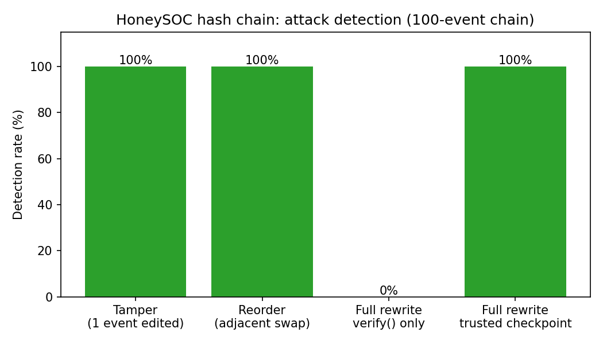
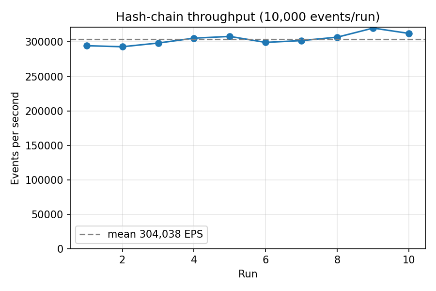

# HoneySOC: Tamper-Evident Honeypot Log Ingestion with a Cryptographic Hash Chain

HoneySOC is a small Security Operations Center (SOC) prototype. A honeypot streams attack events into a Redis queue; the SOC engine pulls each event and links it to the previous one with a SHA-256 hash chain, so any later modification or reordering of the log is detectable.

This repository contains the code, an offline simulation that needs no network or Redis, and its measured results.

---

## How It Works

```
Honeypot (honeypot_sender.py) --LPUSH--> Redis queue "soc_queue" --BRPOP--> SOC engine (soc_ingestion.py)
                                                                              |
                          hash_i = SHA256( JSON(event_i, sorted keys) + hash_(i-1) ),  hash_0 = SHA256("HoneySOC_Genesis_Block")
```

| File | Purpose |
|---|---|
| `honeypot_sender.py` | Producer: sends 100 synthetic SQL-injection-labelled events to `soc_queue` |
| `soc_ingestion.py` | Consumer: pulls events and prints the linked hashes (chain state kept in memory) |
| `redis_config.py` | Creates the Redis client from the `REDIS_URL` environment variable |
| `simulate.py` | Offline demo: builds a 100-event chain, verifies it, checks tamper and reorder detection |
| `benchmark.py` | 10,000-event serialization + hash micro-benchmark |
| `analyze_chain.py` | Extra offline analysis: full tamper/reorder sweeps, full-rewrite case, repeated benchmark, figures |

## How to Run

### Offline simulation (no Redis, no network)

Python 3.10+ recommended.

```sh
python simulate.py          # 100-event chain, tamper + reorder detection
python benchmark.py         # 10,000-event hash-chain micro-benchmark

python -m pip install -r requirements-analysis.txt
python analyze_chain.py     # sweeps + figures written to results/
```

### Redis simulation

```sh
python -m venv .venv
source .venv/bin/activate        # Windows: .venv\Scripts\Activate.ps1
python -m pip install -r requirements.txt

export REDIS_URL='redis://localhost:6379/0'    # use rediss:// for a TLS service
python soc_ingestion.py          # terminal 1: consumer
python honeypot_sender.py        # terminal 2: producer
```

Use a dedicated test Redis instance, because the consumer removes entries from `soc_queue`. Credentials are never stored in the code; pass them through `REDIS_URL`. `.env.example` is documentation only (the scripts do not load `.env`).

## Simulation Results

All numbers below come from the scripts in this repository and are saved in `results/`.

### Hash-chain integrity (`simulate.py`, `analyze_chain.py`)

100-event chain:

| Test | Detected |
|---|---|
| Original chain verifies | Yes |
| Modify one event (all 100 positions tried) | 100 / 100 |
| Swap two adjacent events (all 99 pairs tried) | 99 / 99 |
| Attacker edits an event **and recomputes all later hashes**, checked with `verify()` alone | 0 / 100 |
| Same full rewrite, compared against an independently stored trusted head hash | 100 / 100 |

<p align="center"></p>

The chain alone does not stop an attacker who rewrites every subsequent hash. Detecting that case needs an independently trusted checkpoint (for example, the latest hash stored or signed elsewhere).

### Throughput (`benchmark.py`, 10 repeated runs)

| Metric | Value |
|---|---|
| Events per run | 10,000 |
| Mean throughput | about 304,000 events/s |
| Std. dev. across runs | about 8,300 events/s |
| Min / max | about 293,000 / 320,000 events/s |
| Mean latency per event | about 0.003 ms |

<p align="center"></p>

Raw outputs: `results/simulate_output.json`, `results/benchmark_output.txt`, `results/benchmark_runs.csv`, `results/chain_analysis_summary.json`.

## Limitations

- Throughput and latency measure serialization plus hashing only. They exclude Redis, networking, storage and full SOC processing, and vary with the machine used.
- The consumer keeps chain state in memory; it resets on restart and logs are not persisted.
- A hash chain provides tamper evidence, not tamper prevention: without an independently trusted checkpoint, a full rewrite of later hashes is not detected.
- Events are synthetic. The live Redis workflow (`soc_ingestion.py` with `honeypot_sender.py`) has not been tested end to end in this repository.
- The original hard-coded credentials were removed and must be rotated before reuse of the source service.
